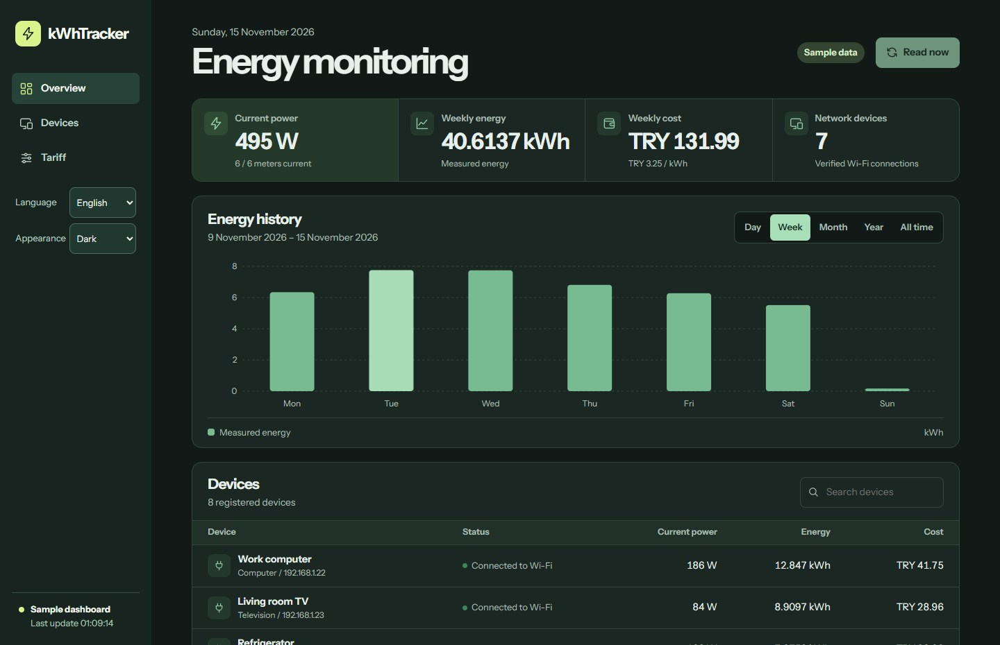
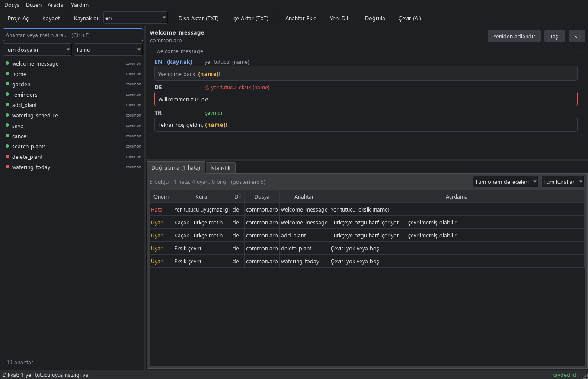

I build mobile apps with Flutter, desktop utilities for Windows, and tools you can run on your own server.

[Mobile apps](#mobile-apps) · [Open source](#open-source) · [Türkçe](#türkçe)

## Mobile apps

- **[Mola](https://apps.apple.com/app/id6823596542)** · A collection of logic puzzles and games that work offline. Includes a daily puzzle and saves unfinished games.
- **[İslam 365](https://apps.apple.com/app/id6760902384)** · A multilingual app for prayer times, Quran reading, and daily worship. Also available on [Google Play](https://play.google.com/store/apps/details?id=com.umitapps.islami_hesap_makinesi).

## Open source

<table>
  <tr>
    <td width="50%" valign="top">
      
      <h3><a href="https://github.com/umitturkmen/kWhTracker">kWhTracker</a></h3>
      
Track Windows PC power, hardware sensors, uptime, and estimated electricity costs on a self-hosted dashboard.

      
Node.js · SQLite

    </td>
    <td width="50%" valign="top">
      
      <h3><a href="https://github.com/umitturkmen/ArbStudio">ARB Studio</a></h3>
      
Edit Flutter translations side by side, validate placeholders, and send text to a translator with TXT export and import.

      
Python · PySide6

    </td>
  </tr>
</table>

- **[EasyPCManager](https://github.com/umitturkmen/EasyPCManager)** · A Windows utility for switching displays, audio outputs, and gaming setups. Built with C# and WPF.

## Türkçe

Flutter ile mobil uygulamalar, Windows için masaüstü araçları ve kendi sunucunda çalıştırabileceğin web panelleri geliştiriyorum.

- **[Mola](https://apps.apple.com/tr/app/id6823596542)** çevrimdışı oyunlar sunuyor, her gün yeni bir bulmaca veriyor ve yarım kalan oyunları kaydediyor.
- **[İslam 365](https://apps.apple.com/tr/app/id6760902384)** namaz vakitlerini, Kur’an okumayı ve günlük ibadet araçlarını bir araya getiriyor.
- **[kWhTracker](https://github.com/umitturkmen/kWhTracker)** Windows bilgisayarının güç tüketimini, sensörlerini, açık kalma süresini ve tahmini elektrik maliyetini gösteriyor.
- **[ARB Studio](https://github.com/umitturkmen/ArbStudio)** Flutter çevirilerini bir arada düzenliyor ve eksik anahtarlarla yer tutucu hatalarını kontrol ediyor.
- **[EasyPCManager](https://github.com/umitturkmen/EasyPCManager)** monitör, ses çıkışı ve oyun ayarları arasında geçişi kolaylaştırıyor.
